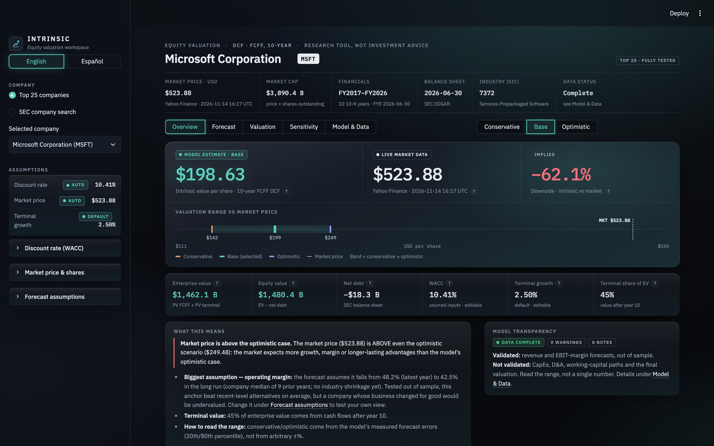

# Intrinsic

**Automated discounted-cash-flow valuation of US public companies, built from SEC filings and validated out of sample.**

Pick a company and Intrinsic downloads its 10-K financial statements from SEC EDGAR, audits the data, forecasts
ten years of free cash flow to the firm (FCFF) with a single driver-based model, discounts it at a sourced WACC
and shows the intrinsic value per share as a range next to the market price. Every assumption is labelled with
where it comes from and stays editable. The interface is available in **English and Spanish**.



**Technical report:** [English (PDF)](docs/Intrinsic_Report_EN.pdf) · [Español (PDF)](docs/Intrinsic_Informe_ES.pdf)
· [read on GitHub](docs/REPORT.md) · [leer en GitHub](docs/INFORME.md)

> Portfolio project by a recent graduate, built to demonstrate financial modelling, data engineering and
> quantitative validation. Research tool, not a professional investment product. Not investment advice.

---

## What makes it different

- **One integrated model, not a model zoo.** Revenue growth, operating margin, capital intensity, working capital
  and tax all follow the same rule: start from the latest year, converge to a long-run anchor at a speed
  estimated from thousands of companies. CapEx and D&A come from a PP&E roll-forward, so they cannot contradict
  each other.
- **Validated before it was trusted.** Fade speeds were estimated on companies with data up to 2018; the design
  and pass/fail criteria were frozen *before* the test; forecasts were then scored on 800 companies the model had
  never seen, for 2019 onward. 5 of 5 criteria passed.
- **Failures are documented, not hidden.** Earlier approaches that lost out of sample (per-metric model
  selection, alternative margin anchors) are kept in `archive/` and summarised below.
- **It refuses rather than guesses.** Missing statements block the valuation instead of being filled with zeros;
  banks, insurers and holding companies are routed to an "outside the scope of this model" page.

## How a valuation is built

```
SEC EDGAR (CompanyFacts, submissions)            Yahoo Finance            Damodaran (Jan 2026)
        │                                              │                          │
        ▼                                              ▼                          ▼
 sec_data · sec_tags · sec_history            market_data · market_reference   industry_beta · wacc_inputs
 balance_sheet · operating_capital                    │                          │
        │  audited 10-year history + net-debt bridge   │ price, shares, Treasury  │ betas, ERP, rating spreads
        ▼                                              ▼                          ▼
 inputs.load_inputs ───────────────► forecast.run ◄──────────── wacc_data ─► WACC
                                         │  10-year FCFF, terminal value, equity bridge
                                         ▼
                                 dashboard_panel (Streamlit)
```

### Forecast mechanics (`intrinsic/forecast.py`)

| Driver | Rule | Source of the parameters |
|---|---|---|
| Revenue growth | `g_t = g_T + (g_0 − g_T)·φ^t` | `g_0` latest year; `φ` estimated on a panel of 2,578 companies by size bucket |
| Operating margin | `m_t = m* + (m_0 − m*)·ψ^t` | `m*` = median of the company's prior 9 years; `ψ` panel-estimated |
| Fixed assets | `NetPPE_t = k_t · Revenue_t` | company history, panel-estimated convergence |
| Depreciation | `δ · NetPPE_{t−1}` | company depreciation rate |
| CapEx | `ΔNetPPE + depreciation` | follows from the two lines above |
| Working capital | `n_t · Revenue_t` (negative allowed) | company median |
| R&D | capitalised and amortised over an industry life | SIC-based asset life |
| Terminal value | `NOPAT_{H+1} · (1 − g / RONIC)` | reinvestment consistent with terminal growth |

Conservative and optimistic scenarios are the 20th / 80th percentiles of the model's *own measured* forecast
errors, scaled to each company's volatility — not arbitrary ±%.

### Discount rate (`intrinsic/wacc_data.py`, `intrinsic/wacc_inputs.py`, `intrinsic/industry_beta.py`)

| Input | Default | Why |
|---|---|---|
| Risk-free rate | live US 10-year Treasury yield | matches the long duration of equity cash flows |
| Equity risk premium | Damodaran implied ERP, 1 Jan 2026 (4.23%) | market-implied, dated |
| Beta | industry unlevered beta (cash-corrected), relevered with the company's D/E | far less noise than one stock's regression beta |
| Cost of debt | risk-free + default spread of a synthetic rating from interest coverage | today's borrowing cost, not old coupons |
| Tax rate | 25% marginal (21% federal + ~4% state) | same rate the forecast converges to |

## Validation

Frozen design: `validation/results/frozen_design.json` · results: `validation/results/final_validation.json`.
Development companies (data ≤ 2018) → 800 fresh NYSE/Nasdaq companies, forecasts from 2019 onward, errors
clustered by company (block bootstrap 95% CIs), figures as originally reported (first vintage).

| Horizon | Revenue error (MAE, log level %) — Intrinsic | Historical median | Random walk |
|---|---:|---:|---:|
| 1 year | **15.8** | 17.6 | 20.3 |
| 3 years | **31.4** | 41.9 | 61.6 |
| 5 years | **37.8** | 57.6 | 86.2 |

| Horizon | Operating-margin error (MAE, pp) — Intrinsic | Historical median | Random walk |
|---|---:|---:|---:|
| 1 year | **8.3** | 11.4 | 8.5 |
| 3 years | **10.9** | 11.6 | 11.7 |
| 5 years | **11.2** | 12.0 | 12.4 |

Revenue bias at 5 years: −5.8% (criterion: |bias| < 10%). All five pre-registered criteria passed.

**What is not validated:** CapEx, D&A and working-capital paths (consistent by construction, not scored as
forecasts), years 6–10 and the terminal value (the panel only supports 5-year tests), and the accuracy of the
final valuation itself.

### What was tested and rejected

| Idea | Result |
|---|---|
| Choose the best method per metric from past errors (Adaptive Selector 26D) | Selections were unstable on small samples and did not consistently beat the best single method out of sample. Replaced by one integrated model. |
| Margin anchor = median of 3 or 5 years, industry median, or a 50/50 blend | None beat the 9-year median (`validation/compare_margin_anchors.py`). |
| Move the margin anchor to recent levels when the last 3 years all sit above/below the median | Pre-registered, rejected: errors at 3 and 5 years were higher (`validation/compare_regime_anchor.py`). |

## Coverage beyond the Top 25 (universal engine, beta)

The dashboard is fully tested on the Top 25 list (22 valued; JPMorgan, Bank of America and Berkshire Hathaway
are financial companies and out of scope). For any other SEC filer, `validation/universe_coverage.py` draws a
fixed random sample of NYSE/Nasdaq companies (one listing per company) and runs the same steps as the dashboard.
Latest run, 60 non-financial companies (seed 2026):

| Outcome | Companies |
|---|---:|
| **Valued** | **22 (37%)** |
| Refused: foreign private issuer (Form 20-F / IFRS) | 18 |
| Refused: loss-making, no positive terminal operating profit | 11 |
| Refused: reported depreciation unusable for the PP&E roll-forward | 4 |
| Refused: no revenue yet / first revenue year | 3 |
| Refused: fewer than 3 years of history | 2 |
| Unexpected errors | **0** |

Among US companies filing a 10-K, 52% are valued; among those that are also profitable, 71%. Every refusal
shows its reason in the dashboard instead of a number. Supporting 20-F filers and loss-making companies are the
next steps for the universal engine.

## Limitations

- Non-financial companies only; banks, insurers, REITs and holding companies are not valued.
- One SIC code per company, so multi-segment businesses (a retailer with a cloud division) get a single
  industry beta — the dashboard lets you choose another industry.
- The long-run margin anchor is the largest assumption for companies whose economics changed recently; the
  Overview page states it explicitly so it can be challenged.
- Market data comes from Yahoo Finance and can be unavailable or rate-limited.

## Project structure

```
app.py                  Streamlit entry point (inputs and layout)
intrinsic/              valuation engine
  inputs.py             load and audit a company's SEC history and net-debt bridge
  forecast.py           driver model, terminal value, valuation, consistency checks
  sec_data.py           cached SEC EDGAR access, annual facts as originally reported
  sec_history.py        historical statements from XBRL tags
  balance_sheet.py      balance-sheet normalisation
  operating_capital.py  PP&E, working capital, R&D capitalisation
  sec_tags.py           XBRL tag lists and audit
  sector_routing.py     SIC-based routing (FCFF vs out of scope)
  wacc_data.py          market cap, debt, interest coverage, industry beta
  wacc_inputs.py        risk-free rate, ERP, synthetic-rating cost of debt, tax
  industry_beta.py      SIC → Damodaran industry, Hamada relevering
  market_data.py, market_reference.py, sec_client.py, company_directory.py
  dashboard_panel.py    Overview · Forecast · Valuation · Sensitivity · Model & Data
  ui/                   design system (theme.py), HTML components and English/Spanish translations (i18n.py)
validation/             calibration, out-of-sample tests and universe coverage (results in validation/results/)
data/                   calibration, Damodaran snapshots, SEC company list
tests/                  unit tests (79), including translation coverage
docs/                   technical report (EN/ES, Markdown and PDF) and figures
archive/                earlier iterations, not used (see archive/README.md)
```

## Run it locally

```bash
python -m venv .venv && source .venv/bin/activate
pip install -r requirements.txt
export INTRINSIC_SEC_USER_AGENT="Intrinsic your.name@example.com"   # SEC requires a contact
streamlit run app.py
```

SEC responses are cached in `.intrinsic_cache/` (ignored by git).

```bash
python -m unittest discover -s tests              # unit tests
python -m validation.compare_regime_anchor        # re-run an anchor test from the cached panel
python -m validation.calibrate_fade --n 500       # rebuild the panel and calibration (downloads SEC data)
python -m validation.final_validation             # re-score the frozen design on fresh companies
python -m validation.top25_check                  # data and model readiness for the dashboard universe
python -m validation.universe_coverage            # how much of the SEC universe the dashboard can value
```

## Data sources

- **SEC EDGAR** — XBRL CompanyFacts and submissions (public domain).
- **Yahoo Finance** via `yfinance` — prices, shares outstanding, 10-year Treasury yield.
- **Aswath Damodaran, NYU Stern** — industry betas, implied equity risk premium, synthetic rating spreads
  (January 2026 datasets), stored as dated snapshots in `data/`.
