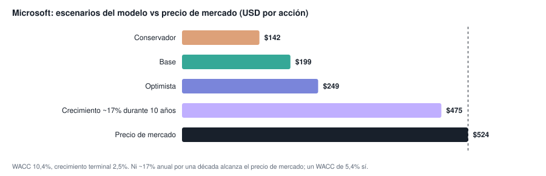

# Intrinsic — Valoración DCF automatizada a partir de reportes de la SEC

**Informe técnico** · Noviembre 2026 · **App en vivo:** [intrinsic-dcf.streamlit.app](https://intrinsic-dcf.streamlit.app) · *English version: [REPORT.md](REPORT.md)*

> Intrinsic es un proyecto de portafolio creado para demostrar modelación financiera, ingeniería de datos y
> validación cuantitativa. Es una herramienta de investigación, no un producto profesional de inversión, y nada
> en él constituye asesoría de inversión.


---

## 1. Resumen

Intrinsic valora empresas que cotizan en EE. UU. con un modelo de **flujo de caja libre de la empresa (FCFF)**
descontado a diez años, construido solo con datos públicos: estados financieros de **SEC EDGAR**, datos de
mercado de **Yahoo Finance** y conjuntos de referencia fechados de **Aswath Damodaran (NYU Stern)**. El usuario
elige una empresa y la aplicación descarga su historia de reportes 10-K, la audita, proyecta ingresos, márgenes
y reinversión, descuenta los flujos a un costo de capital con fuentes y muestra el valor intrínseco por acción
como un rango frente al precio de mercado, en inglés o en español.

Tres decisiones de diseño lo distinguen de un DCF típico de estudiante:

1. **Un solo modelo integrado por impulsores**, no una colección de reglas por métrica. Cada variable parte del
   último año reportado y converge a un ancla de largo plazo a una velocidad estimada en 2.578 empresas; el
   CapEx y la depreciación salen del mismo roll-forward del activo fijo, así que no pueden contradecirse.
2. **Validado antes de confiar en él.** El diseño y cinco criterios de aprobación se congelaron antes de probarlo
   con 800 empresas que el modelo nunca había visto, proyectando desde 2019. Cumplió los cinco. Las ideas que
   perdieron fuera de muestra se descartaron y quedaron documentadas.
3. **Rechaza en lugar de adivinar.** Los estados financieros faltantes bloquean la valoración en vez de rellenarse
   con ceros; REIT, empresas que reportan en monedas hiperinflacionarias y empresas en etapa de
   desarrollo se rechazan mostrando el motivo.

## 2. El problema

Automatizar un DCF es fácil; automatizar uno *defendible* no lo es. Las primeras versiones de Intrinsic usaban
promedios y medianas históricas para cada métrica, y fallaban de forma predecible: los promedios ignoran los
cambios estructurales (el gasto de capital de Microsoft desde 2023), extrapolan crecimientos extraordinarios
(NVIDIA) y tratan cada línea del flujo de caja por separado, de modo que CapEx y depreciación podían terminar en
combinaciones económicamente imposibles. Dos enfoques más elaborados —un modelo "híbrido" de corto y largo plazo
y un *selector adaptativo* que elegía el mejor método por métrica según errores pasados— daban valoraciones muy
distintas para la misma empresa y no se pudo demostrar que fueran mejores fuera de muestra.

El objetivo pasó a ser: **un solo modelo, cada parámetro medido con datos o marcado como supuesto, y toda
afirmación sobre su precisión respaldada por una prueba fuera de muestra.**

## 3. Arquitectura

```
 SEC EDGAR (CompanyFacts, submissions)       Yahoo Finance               Damodaran, ene 2026
            │                                      │                             │
            ▼                                      ▼                             ▼
  sec_data · sec_tags · sec_history       market_data · market_reference   industry_beta · wacc_inputs
  balance_sheet · operating_capital                │                             │
            │  historia auditada de 10 años,        │ precio, acciones,           │ betas por industria,
            │  puente al patrimonio, sector         │ bono del Tesoro a 10 años   │ prima implícita, spreads
            ▼                                      ▼                             ▼
     inputs.load_inputs ───────────────►  forecast.run  ◄──────────────  wacc_data → WACC
                                               │  FCFF a 10 años, valor terminal, puente al patrimonio
                                               ▼
                         dashboard_panel + app.py (Streamlit, inglés / español)
```

El código es un paquete de Python (`intrinsic/`) con una interfaz en Streamlit (`app.py`), una carpeta
`validation/` con todos los scripts de calibración y prueba, datos de referencia fechados en `data/` y 188 tests
unitarios que GitHub Actions corre en cada push. Las versiones anteriores se conservan, sin uso, en `archive/`.

## 4. Pipeline de datos

**Fuente.** El *CompanyFacts* en XBRL de cada empresa (cada número etiquetado de cada 10-K) y el endpoint
*submissions* (código de industria SIC, tipo de emisor). Las respuestas se guardan en caché local; la SEC exige
un User-Agent identificable, que se lee de una variable de entorno.

**Tal como se reportó originalmente.** CompanyFacts mezcla valores originales y reexpresados. Para calibrar y
validar, Intrinsic toma el valor **presentado por primera vez** de cada año fiscal, así una proyección hecha "en
2018" solo usa lo que se sabía en 2018. El dashboard en vivo usa los valores más recientes.

**Conciliación de etiquetas.** Las empresas reportan el mismo concepto con distintas etiquetas XBRL (por ejemplo,
los ingresos con cinco etiquetas alternativas, la deuda como total o por componentes). Cada línea tiene una lista
de prioridad; un total reportado siempre gana sobre una suma de componentes parciales, y cada valor guarda la
etiqueta de la que salió. Si falta la utilidad operativa, se deriva de la utilidad antes de impuestos y los
intereses, y se marca como *derivada*.

**Puente al patrimonio.** Deuda neta = deuda (incluidos arrendamientos financieros) − caja − inversiones de corto
plazo − inversiones no operativas, todo a la misma fecha de balance. Las acciones son el promedio ponderado
diluido del último año.

**Clasificación por sector.** El código SIC decide si aplica el FCFF. Los REIT y las sociedades de cartera se
envían a una página de "fuera del alcance de este modelo" *antes* de cargar datos de mercado, con una explicación de
por qué necesitan otro modelo. Los bancos y las aseguradoras van al motor de patrimonio que se describe a
continuación.

**Bancos y aseguradoras: motor de patrimonio.** Para un banco, los depósitos son materia prima; para una
aseguradora, las reservas de los asegurados; ninguno es financiamiento, así que el flujo de caja libre de la firma y
el WACC no aplican. Ambos se valoran sobre el patrimonio al costo del patrimonio de CAPM (beta apalancada de la
industria de Damodaran, usada directamente) con dos modelos lado a lado: un modelo de rendimiento en exceso
(ingreso residual), valor en libros más el valor presente del ROE por encima del costo del patrimonio, con el ROE
convergiendo desde su media de 3 años hasta su mediana de largo plazo; y un modelo de descuento de dividendos de dos
etapas sobre dividendos más recompras. El valor es el punto medio, y se muestra la brecha entre ambos. Las
aseguradoras (noviembre de 2026) necesitan tres ajustes a sus cifras reportadas: *(1)* desde 2018 las ganancias en
acciones, realizadas o no, pasan por la utilidad neta (ASU 2016-01), así que la utilidad operativa las excluye
después de un impuesto del 21% (las demás ganancias realizadas se mantienen: en las aseguradoras de vida son sobre
todo coberturas que compensan cambios en pasivos que también están en la utilidad neta); *(2)* el valor en libros
excluye el AOCI, que se mueve con el precio de los bonos; *(3)* cuando la cartera de acciones es al menos el 10% del
patrimonio común, se separa del valor en libros y de las utilidades (con sus dividendos, etiquetados o con un
rendimiento supuesto del 2%) y se suma de nuevo a valor de mercado neto del impuesto diferido sobre su ganancia no
realizada, porque se espera que una cartera a valor de mercado rinda justo su rendimiento requerido. En Berkshire
Hathaway la cartera separada vale $253 mil millones y los modelos valoran el resto: la suscripción, el ingreso por
invertir el float, el ferrocarril, las eléctricas y las demás empresas operativas; el ROE operativo fue de 3% a 17%
en 2019–2025, frente a un ROE reportado de −5% a +23%. Las dos clases de acciones de Berkshire se cuentan en
unidades de clase B como capitalización ÷ precio, porque la portada del 10-K ya no trae un total. Ninguno de los dos
motores tiene backtest; la velocidad de convergencia y las reglas de los escenarios son supuestos económicos.

**Emisores extranjeros (noviembre 2026).** Las empresas que presentan el Form 20-F o 40-F se adaptan al
cargar los datos para que el motor las lea como si presentaran el 10-K: el informe anual se reetiqueta; los
conceptos IFRS se traducen a sus equivalentes US GAAP (los pasivos por arrendamiento de IFRS 16 se tratan como
deuda, en línea con una utilidad operativa antes de los intereses de arrendamiento); los montos en otra moneda se
convierten a USD con tipos de cambio de Yahoo Finance, los flujos al promedio del año fiscal y los saldos al tipo
de cierre, y se descartan las traducciones de conveniencia para no mezclar monedas. Las monedas
hiperinflacionarias (NIC 29, p. ej. ARS, TRY) se rechazan. Las acciones cotizan como ADS: la equivalencia se
deduce de las acciones ordinarias de la SEC frente al conteo de mercado (número entero con un margen de 5%); si
no cuadra, se usa el conteo de mercado y se señala. Las empresas de EE. UU. con 10-K no cambian.

**Política de rechazo.** Una valoración se bloquea, mostrando el motivo, cuando no se pueden verificar los
ingresos, la utilidad operativa, el activo fijo o el puente al patrimonio; cuando la empresa reporta en una
moneda hiperinflacionaria; cuando tiene menos de tres años de historia; o cuando la proyección nunca alcanza
una utilidad operativa terminal positiva.

## 5. Modelo de proyección

Cada impulsor sigue la misma regla: parte de la última observación y converge a un ancla de largo plazo.

| Impulsor | Ecuación | Parámetros |
|---|---|---|
| Crecimiento de ingresos | g<sub>t</sub> = c<sub>t</sub> + (g<sub>0</sub> − c) · φ<sup>t</sup>; c<sub>t</sub> = c en los años 1–5, luego lineal hasta g<sub>T</sub> en el año 10 | g<sub>0</sub> último crecimiento; c crecimiento mediano del panel (6,8%); g<sub>T</sub> crecimiento terminal (2,5%); φ estimado en el panel |
| Margen operativo | m<sub>t</sub> = m\* + (m<sub>0</sub> − m\*) · ψ<sup>t</sup> | m\* mediana de los 9 años anteriores; ψ estimado en el panel |
| Intensidad de capital | ActivoFijo<sub>t</sub> = k<sub>t</sub> · Ingresos<sub>t</sub> | k converge a la mediana de la empresa |
| Depreciación | Dep<sub>t</sub> = δ · ActivoFijo<sub>t−1</sub> | δ de la historia de la empresa |
| CapEx | ΔActivoFijo<sub>t</sub> + Dep<sub>t</sub> | se deriva de las dos líneas anteriores |
| Capital de trabajo | CT<sub>t</sub> = n<sub>t</sub> · Ingresos<sub>t</sub> | puede ser negativo (los clientes financian el crecimiento) |
| I+D | capitalizado y amortizado según la vida útil de la industria | vida útil según el SIC |
| Impuestos | tasa efectiva → 25% marginal al año 10 | 21% federal + ~4% estatal |
| Valor terminal | NOPAT<sub>H+1</sub> · (1 − g / RONIC) / (WACC − g) | reinversión consistente con el crecimiento |

**Empresas con pérdidas (noviembre 2026).** Cuando la mediana de nueve años del margen de la empresa no es
positiva, o la convergencia todavía deja una pérdida operativa en el año 10, la mediana no puede ser el ancla:
proyectaría pérdidas para siempre. En su lugar, el margen avanza en línea recta desde el nivel actual hasta el
margen operativo de su **industria** (Damodaran, enero 2026, con el mismo mapeo SIC que la beta; el del mercado
de EE. UU. sin financieras cuando la industria es pequeña o pierde dinero) en 7 años, y el valor se pondera por
una probabilidad de quiebra: valor = (1 − p) · valor de empresa en marcha + p · caja neta (mínimo cero). La p por
defecto sale de cuántos años de caja le quedan (caja e inversiones de corto plazo / última pérdida operativa):
5 o más años 10%, 2–5 años 20%, 1–2 años 35%, menos de 1 año 50%; 5% si el último año ya fue rentable. La meta,
los años y p son supuestos editables, no proyecciones validadas. Las empresas cuyas pérdidas operativas superan
sus ingresos se siguen rechazando (etapa de desarrollo). La volatilidad que escala las bandas de escenario tiene
un tope (crecimiento 0,45, margen 0,15), por encima de toda empresa del Top 25, para que las historias erráticas
de empresas pequeñas no produzcan escenarios optimistas sin sentido. Ninguna de las 22 empresas valoradas del
Top 25 cambia.

**Calibración.** Los pesos de convergencia se estiman en un panel de 2.578 empresas no financieras de NYSE y
Nasdaq, regresando la desviación futura respecto del ancla sobre la desviación de hoy, de 1 a 5 años adelante.
Las estimaciones por tamaño de ingresos se ajustan hacia el valor de todas las empresas (agrupación parcial con
200 pseudo-observaciones). Valores actuales: φ = 0,19 para el crecimiento (el exceso de crecimiento se disipa
rápido), ψ = 0,87 para el margen y 0,98 para la intensidad de capital (ambos persistentes). El crecimiento se
mide respecto del crecimiento mediano del panel, c = 6,8%, así que el pronóstico disipa el exceso hacia c y no
directamente hacia el crecimiento terminal; luego c baja linealmente al crecimiento terminal en los años 6–10.
(Hasta noviembre de 2026 el pronóstico convergía directo a 2,5%, lo que contaba dos veces la reversión y
recortaba los valores entre 15% y 30%.)

**Escenarios.** El conservador y el optimista son los percentiles 20 y 80 de los propios errores fuera de muestra
del modelo para ingresos y margen, escalados a la volatilidad histórica de cada empresa. El conservador además
supone que, en el período terminal, la nueva inversión solo rinde su costo de capital.

## 6. Tasa de descuento

| Dato | Valor por defecto y fuente | Por qué |
|---|---|---|
| Tasa libre de riesgo | Rendimiento del bono del Tesoro a 10 años del día (Yahoo Finance ^TNX) | coincide con la larga duración de los flujos del patrimonio |
| Prima de riesgo de mercado | 4,23%, prima implícita del S&P 500 de Damodaran, 1 de enero de 2026 | implícita en el mercado y fechada |
| Beta | Beta desapalancada de la industria (corregida por caja), reapalancada con el D/E de la empresa: β<sub>L</sub> = β<sub>U</sub>(1 + (1 − t)·D/E) | el promedio de muchas empresas tiene mucho menos ruido que la regresión de una sola acción |
| Costo de la deuda | Tasa libre de riesgo + spread de una calificación sintética según la cobertura de intereses (EBIT / intereses) | el costo de endeudarse hoy, no cupones antiguos |
| Tasa impositiva | 25% marginal | la misma tasa a la que converge la proyección |

El código SIC se asigna a las 94 industrias de Damodaran con una tabla explícita; cada asignación se marca como
*específica* o *amplia*, y el usuario puede elegir otra industria cuando un solo código no describe un negocio
con varios segmentos. Cada dato muestra su fuente y se puede editar.

## 7. Validación

### 7.1 Diseño

Los parámetros se estimaron con empresas de desarrollo usando datos hasta el 31 de diciembre de 2018. El diseño
—versión de los datos, definición del ancla, horizontes y cinco criterios de aprobación— se guardó en
`validation/results/frozen_design.json` **antes** de evaluar las proyecciones en 800 empresas nuevas de NYSE y
Nasdaq desde 2019. Los errores se agrupan por empresa, por eso los intervalos de confianza usan un bootstrap por
bloques de empresa.

| Criterio | Resultado |
|---|---|
| R1 · ingresos a 3 años: supera al paseo aleatorio (límite superior del IC < 0) | Cumple |
| R2 · ingresos a 5 años: supera al paseo aleatorio | Cumple |
| R3 · ingresos a 5 años: supera a la mediana histórica | Cumple |
| M1 · margen: no es peor que el paseo aleatorio en ningún horizonte | Cumple |
| B1 · sesgo de ingresos a 5 años menor a 10% | Cumple (−5,8%) |

### 7.2 Resultados


| Horizonte | MAE de ingresos (nivel en log, %): Intrinsic / mediana / paseo aleatorio | MAE de margen (pp): Intrinsic / mediana / paseo aleatorio |
|---|---|---|
| 1 año | **15,8** / 17,6 / 20,3 | **8,3** / 11,4 / 8,5 |
| 3 años | **31,4** / 41,9 / 61,6 | **10,9** / 11,6 / 11,7 |
| 5 años | **37,8** / 57,6 / 86,2 | **11,2** / 12,0 / 12,4 |

La mejora es mayor justo donde un DCF la necesita: a cinco años el error de ingresos es un tercio menor que el de
la mediana histórica y menos de la mitad que el de extrapolar el crecimiento actual.

### 7.3 Lo que se probó y se descartó

| Idea | Resultado |
|---|---|
| Selector adaptativo: elegir el mejor método por métrica según errores pasados | Inestable con muestras pequeñas; no superó de forma consistente al mejor método individual. Reemplazado por un solo modelo. |
| Ancla del margen = mediana de 3 o 5 años, mediana de la industria o una mezcla 50/50 | Ninguna superó a la mediana de 9 años (`validation/compare_margin_anchors.py`). |
| Mover el ancla a niveles recientes cuando los últimos tres años están todos por encima (o por debajo) de la mediana | Registrada de antemano y descartada: en los casos donde se activaba, el error subió de 8,22 a 8,46 pp a 3 años y de 9,22 a 9,54 pp a 5 años (`validation/compare_regime_anchor.py`). |

### 7.4 Cobertura más allá del Top 25

El dashboard está probado a fondo con su lista Top 25 (22 con el modelo FCFF; JPMorgan y Bank of America con el
motor bancario; Berkshire Hathaway con el motor de aseguradoras). Sus 22 valoraciones FCFF quedan congeladas
como referencia de regresión (`validation/top25_baseline.py`, noviembre de 2026): los datos de la SEC se guardan en
`tests/fixtures` y una prueba unitaria falla si el motor, la calibración o el conjunto de errores del Monte Carlo
cambian algún estado, precio de escenario o cuantil simulado, de modo que ampliar el motor a más empresas no puede
cambiar estas 22 sin que se note. `validation/universe_coverage.py` toma empresas al azar de NYSE y Nasdaq,
una acción por empresa, y repite los mismos pasos que el dashboard. Con 60 empresas no financieras: **40
valoradas (67%)**, frente a 22 (37%) antes del camino a la rentabilidad y del adaptador de emisores extranjeros;
7 rechazadas por estar en etapa de desarrollo, 6 por datos de depreciación inutilizables, 3 sin ingresos todavía,
2 con menos de tres años de historia, 1 por moneda hiperinflacionaria y 1 sin utilidad operativa etiquetada;
**cero errores inesperados**. De los 18 emisores extranjeros, hoy se valoran 11. (El script de cobertura también
dejó de contar como valoradas a empresas sin conteo de acciones en la SEC antes de correr el modelo; un caso
estaba mal contado.)

### 7.5 ¿Predicen las señales del veredicto los rendimientos? (backtest histórico, noviembre de 2026)

`validation/verdict_backtest.py` reconstruye la valoración del dashboard **a la fecha de cada presentación** para
las 403 empresas del panel que la calibración dejó fuera (CIK % 5 = 0): los estados solo incluyen hechos presentados
hasta esa fecha, el precio es el de dos días hábiles después (corregido por splits posteriores), la tasa libre de
riesgo es el bono del Tesoro a 10 años de ese día, la prima de riesgo es la implícita de Damodaran publicada ese
año, y el Monte Carlo usa errores estimados solo con empresas de entrenamiento. Resultado medido: rendimiento total
a 1, 3 y 5 años menos el del S&P 500 (SPY).

1.506 10-K originales (años fiscales de mediados de 2012 a 2020) de 214 empresas; 189 no tienen ninguno (108
presentan el formulario 20-F y 81 empezaron a cotizar después de 2020). Se valoraron 797 (el resto son rechazos de la
propia app: etapa de desarrollo, sin EBIT, puente incompleto); 41 se excluyeron como errores de datos (precio
menor a $1 o valor/precio por encima de 10×, por ejemplo acciones reportadas en miles), y quedan **756 valoraciones
de 129 empresas**. Las estadísticas son robustas a las colas: mediana del exceso, proporción que supera al SPY y
media del exceso *logarítmico*, con intervalos del 95% que remuestrean empresas.

| Horizonte | Corr. de rango P(valor > precio) vs exceso | Quintil superior − inferior de P (exceso log) | Comprar: supera al SPY · media log | Vender: supera al SPY · media log |
|---|---|---|---|---|
| 1 año | +0,05 [−0,01; +0,13] | +7,4% [−0,9%; +16,5%] | 49% · −5,1% | 43% · −9,8% |
| 3 años | +0,08 [−0,03; +0,18] | +20,4% [+0,2%; +44,6%] | 42% · −13,4% | 38% · −24,0% |
| 5 años | +0,03 [−0,08; +0,15] | +26,5% [−2,9%; +62,2%] | 32% · −30,0% | 34% · −41,9% |

Lo que muestra:

- **La señal apunta en la dirección correcta, pero es débil.** Todas las correlaciones de rango son positivas y
  ninguna está claramente por encima de cero; la razón valor base / precio se comporta igual (+0,07 [0,00; +0,14] a
  un año, +0,09 a tres).
- **Identifica sobre todo a los perdedores, no a los ganadores.** La diferencia viene del quintil inferior (P más
  baja, a menudo con valor del modelo negativo): −13% de exceso log a 1 año, −34% a 3 y −59% a 5. Los otros cuatro
  quintiles no se distinguen entre sí.
- **Comprar no le ganó al mercado.** Las señales de compra superaron al SPY el 49%, 42% y 32% de las veces a 1, 3 y
  5 años. Las de venta lo hicieron peor que las de compra en todos los horizontes, pero los intervalos se solapan.
- **P(valor > precio) no es la probabilidad de ganarle al mercado.** En el quintil superior (P de 0,75 a 0,99) solo
  el 47%, 42% y 32% superó al SPY. Por eso la página sigue presentando estas probabilidades como condicionadas al
  modelo.

Límites de la prueba: el panel se construye con empresas que cotizan hoy (data/sec_companies.csv) y Yahoo no tiene
precios de tickers que dejaron de cotizar, así que faltan quiebras y adquisiciones (sesgo de supervivencia; empuja
los rendimientos hacia arriba, y aun así la muestra quedó por debajo del S&P 500, liderado por las megaempresas, en
una mediana de 35% a cinco años); se usan para todos los años las betas de industria, los diferenciales de
calificación, los márgenes de industria y la tasa impositiva de largo plazo de 2026 (información del futuro); las
velocidades de convergencia vienen del panel completo; no hay emisores extranjeros; y 2012–2020 es un solo régimen de
mercado.

## 8. Caso de estudio: Microsoft

*Cifras calculadas el 14 de noviembre de 2026; la aplicación en vivo actualiza los datos de mercado, así que los
valores cambian levemente.*

### 8.1 Historia e impulsores

Los ingresos pasaron de $96,6 mil millones (año fiscal 2017) a $331,8 mil millones (2026); el margen operativo
antes de la amortización de intangibles adquiridos subió de 31,8% a 48,2%.

| Impulsor | Valor | Fuente |
|---|---|---|
| Crecimiento de ingresos, último año | 17,8% | dato |
| Convergencia del crecimiento φ | 0,20 | calibrado (grupo >$100 mil millones combinado con todas las empresas) |
| Margen operativo, último → largo plazo | 48,2% → 42,5% | dato (mediana de los 9 años anteriores) |
| Convergencia del margen ψ | 0,84 | calibrado |
| Activo fijo neto / ingresos, último → largo plazo | 94% → 36% | dato; refleja la reciente inversión en infraestructura de IA |
| Capital de trabajo / ingresos | −8,7% → −15,3% | dato (los clientes pagan por adelantado) |
| Impuestos, efectiva → marginal | 19,4% → 25% | dato / supuesto |

### 8.2 Tasa de descuento

Tasa libre de riesgo 5,15% · prima 4,23% · beta 1,26 (Software — System & Application, desapalancada 1,25 en
309 empresas, D/E 1,0%; beta de regresión de Yahoo 1,05) · costo del patrimonio 10,48% · cobertura de intereses
50,9× → AAA → costo de la deuda antes de impuestos 5,55% · pesos 99,0% patrimonio / 1,0% deuda → **WACC 10,42%**.

### 8.3 Proyección (escenario base, miles de millones de USD)

| | 2027 | 2028 | 2029 | 2030 | 2031 | 2036 |
|---|---:|---:|---:|---:|---:|---:|
| Ingresos | 350,5 | 361,5 | 371,0 | 380,4 | 389,9 | 441,1 |
| Crecimiento | 5,6% | 3,1% | 2,6% | 2,5% | 2,5% | 2,5% |
| Margen operativo | 46,2% | 45,7% | 45,4% | 45,1% | 44,9% | 43,5% |
| NOPAT | 135,9 | 136,8 | 137,3 | 138,3 | 139,8 | 147,2 |
| CapEx | 80,0 | 75,6 | 75,5 | 76,4 | 77,4 | 83,4 |
| D&A | 69,7 | 71,7 | 72,2 | 72,4 | 72,5 | 77,9 |
| FCFF | 124,7 | 131,8 | 133,3 | 133,8 | 134,3 | 140,9 |
| ROIC | 38,7% | 37,3% | 36,7% | 36,4% | 36,3% | 35,5% |

### 8.4 Valoración

| | USD |
|---|---:|
| VP del FCFF, 2027–2036 | 806,4 mil millones |
| VP del valor terminal (44,8% del VE; RONIC 35,7%, reinversión 7,0% del NOPAT) | 654,9 mil millones |
| Valor de la empresa | 1.461,4 mil millones |
| Deuda neta (caja neta) | −18,3 mil millones |
| Valor del patrimonio | 1.479,7 mil millones |
| Acciones diluidas | 7.453 millones |
| **Valor intrínseco por acción (base)** | **$198,53** |
| Conservador / optimista | $141,74 / $249,35 |
| Precio de mercado | $523,88 |



### 8.5 Cómo leer la diferencia

El precio de mercado está por encima incluso del escenario optimista. En lugar de ajustar el modelo hasta que
coincida, Intrinsic se pregunta qué implica el precio con un **DCF inverso** que reutiliza el mismo motor y cambia
un solo impulsor a la vez (ejecución de noviembre de 2026, precio $488, valor base $246, WACC 10,2%):

- **Crecimiento:** los ingresos tendrían que crecer 14,6 puntos al año más que el pronóstico en los años 1–5
  (bajando a cero en el año 10): un promedio de 15,8% al año durante la década en lugar de 5,8%.
- **Margen:** ningún margen operativo de largo plazo hasta 75% reproduce el precio con la trayectoria de ingresos
  pronosticada.
- **Tasa de descuento:** el precio corresponde a un WACC de 6,4%.

El mercado, entonces, descuenta un crecimiento que persiste mucho más tiempo, o un retorno exigido mucho menor, de
lo que respalda la evidencia del modelo. El panel muestra que ese nivel de crecimiento rara vez se ha sostenido, y
por eso la convergencia calibrada es rápida; por la misma razón, el modelo subvalorará a la rara empresa que sí lo
sostenga.

## 9. La aplicación


- **DCF inverso**: lo que la empresa tendría que lograr para que el precio de mercado sea justo. Tres modos, cada
  uno resuelto por separado con el mismo motor y todo lo demás constante: una prima de crecimiento sumada a la
  trayectoria calibrada en los años 1–5 que baja a cero en el año 10 (límites de −15 a +30 puntos al año), el
  margen operativo de largo plazo (0–75%) y el WACC (crecimiento terminal + 0,5 puntos hasta 25%). Primero se
  recorre el rango acotado; luego el método de Brent (`scipy.optimize.brentq`) resuelve dentro de un único
  intervalo. Si no hay solución, hay varias o la respuesta no es monótona, se informa sin forzarla, y se muestra
  el error residual. Son las expectativas incorporadas en el precio, no pronósticos ni una señal de compra o venta.
- **Veredicto final**: Comprar / Mantener / Vender a partir de un **Monte Carlo** de 1.000 valoraciones del caso
  base. Cada simulación toma una trayectoria observada de cinco años de errores de pronóstico de ingresos y
  margen, juntos (`data/joint_errors.json`: 3.925 ventanas de 610 empresas, así se conserva la correlación entre
  ambos errores), una beta ±0,20 y una prima de riesgo ±0,5 puntos (normal), y un crecimiento terminal ±1 punto
  (triangular, por debajo de la tasa libre de riesgo, o del crecimiento terminal del usuario si es mayor, y 1 punto
  bajo el WACC simulado). Los errores vienen de
  empresas del mismo tamaño, escalados por la volatilidad de la propia empresa por debajo de $10 mil millones y
  en puntos a partir de $10 mil millones; las empresas que crecen más de 25% usan un grupo de alto crecimiento.
  Cada decisión se tomó con empresas que quedaron fuera de la estimación (`validation/joint_errors.py`): el 60%
  central de los errores cubre entre 49% y 64% de los errores de esas empresas según tamaño y horizonte, y la
  esquina "ingresos y margen malos a la vez" ocurre en 8,5% de las ventanas, frente a 4% si fueran
  independientes. Después del año 5 el desvío de margen que se mantiene es la mediana de los años 3–5, para que
  un cargo puntual no se vuelva permanente. Comprar es la parte de las valoraciones por encima del precio más un
  margen de seguridad (15% por defecto), Vender la parte por debajo del precio menos ese margen, y Mantener el
  resto; Comprar o Vender necesitan mayoría. La página muestra dónde caen los tres escenarios en la simulación
  (Microsoft: conservador p16, base p57, optimista p84; tratarlos como percentiles 20 y 80 era aproximado, no
  exacto) y el error estándar de la simulación. Los errores de ingresos y margen están medidos; las dispersiones
  de la tasa de descuento y del crecimiento son supuestos; las probabilidades están condicionadas al modelo y no
  calibradas con rendimientos realizados (el backtest histórico de la sección 7.5 encuentra que la señal es débil). Las
  zonas de compra y venta son umbrales sobre el valor del modelo, no precios a los que operar. Los bancos
  mantienen el ajuste por escenarios (una lognormal dividida que pasa por los tres escenarios).
- **Resumen**: valor intrínseco, precio de mercado y potencial implícito; el rango de conservador a optimista
  frente al precio de mercado; valor de la empresa y del patrimonio; un veredicto en lenguaje simple y el
  supuesto más importante.
- **Proyección**: historia reportada y los tres escenarios, una tabla tipo estado financiero (reales vs
  estimados) y exportación a CSV.
- **Valoración**: el puente al patrimonio, cómo se construye el valor año a año y el paso del valor de la
  empresa al valor del patrimonio.
- **Sensibilidad**: una matriz WACC × crecimiento terminal coloreada en torno al precio de mercado.
- **Modelo y datos**: qué está validado y qué no, la fuente de cada impulsor (dato de la empresa, calibrado,
  supuesto económico o dato del usuario) y todas las revisiones de calidad de datos.

Cada dato se puede editar y se marca como *Auto*, *Por defecto*, *Editado* o *Manual*; el color indica el origen
(modelo, mercado, usuario). La interfaz es completamente bilingüe (inglés / español) y un test unitario falla si
algún texto no tiene traducción. El **buscador SEC** abre cualquier empresa registrada bajo un aviso visible de
*beta*.

## 10. Limitaciones y trabajo futuro

- **Alcance.** Empresas no financieras que presentan el Form 10-K bajo US GAAP. Los bancos y las aseguradoras usan
  el motor de patrimonio, que no tiene backtest; en las aseguradoras de vida, las ganancias realizadas se mantienen
  en la utilidad y la contabilidad de contratos de larga duración (LDTI) no se modela. Las empresas con moneda
  hiperinflacionaria y las empresas en etapa de desarrollo se rechazan por ahora. Las empresas con pérdidas se valoran con un camino supuesto a la rentabilidad, que no
  está validado fuera de muestra.
- **Lo que no está validado.** Las trayectorias de CapEx, D&A y capital de trabajo son consistentes por
  construcción pero no se evaluaron como proyecciones; los años 6 a 10, el valor terminal y la valoración final
  no están validados.
- **Ancla del margen.** La mediana de nueve años ganó en promedio fuera de muestra, pero subvalora a una empresa
  cuya economía cambió para siempre. Se muestra en el Resumen y se puede editar.
- **Una industria por empresa.** Un solo código SIC le da a las empresas con varios segmentos una sola beta (un
  minorista con una división de nube); el usuario puede elegir otra industria.
- **Consistencia de arrendamientos (corregido, noviembre 2026).** Los pesos del WACC usaban la deuda financiera
  del balance, mientras que el puente al patrimonio también restaba los arrendamientos financieros (en Microsoft,
  $40,3 mil millones vs $106,9 mil millones). Ahora ambos usan la misma deuda auditada, con arrendamientos
  financieros, y la beta de industria se reapalanca con ella. Efecto: WACC de Microsoft 10,33% → 10,29%, valor
  por acción +$0,94; Amazon +$0,06. El ejemplo resuelto de la sección 8.2 es anterior a esta corrección (peso de
  la deuda de 1,0%).
- **Datos de mercado** de Yahoo Finance, que pueden no estar disponibles o tener límites de uso.

**Próximos pasos:** una prueba fuera de muestra del camino a la rentabilidad, repetir el backtest del veredicto sin
sesgo de supervivencia (precios de empresas que dejaron de cotizar de una fuente histórica),
un backtest del motor de bancos y aseguradoras, y betas ponderadas por segmento.

## 11. Reproducibilidad

El dashboard funciona en vivo en https://intrinsic-dcf.streamlit.app. Para correrlo localmente:

```bash
pip install -r requirements.txt
export INTRINSIC_SEC_USER_AGENT="Intrinsic tu.nombre@ejemplo.com"
streamlit run app.py                               # el dashboard
python -m unittest discover -s tests               # 188 tests unitarios
python -m validation.calibrate_fade --n 500        # reconstruir el panel y la calibración
python -m validation.final_validation              # evaluar el diseño congelado con empresas nuevas
python -m validation.compare_regime_anchor         # una prueba de ancla registrada de antemano
python -m validation.universe_coverage             # cobertura del universo de la SEC
python -m validation.top25_baseline check          # motor frente a la referencia congelada del Top 25 (sin conexión)
```

Datos: SEC EDGAR (dominio público); Yahoo Finance mediante `yfinance`; Aswath Damodaran, NYU Stern — betas por
industria, prima de riesgo implícita y spreads por calificación (enero 2026), guardados como copias fechadas en
`data/`.
