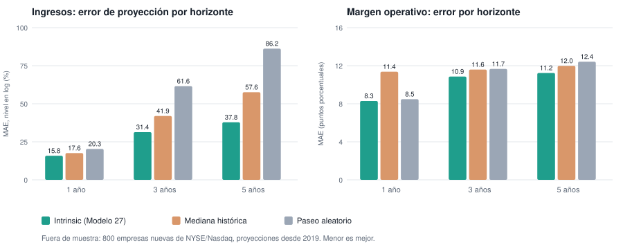
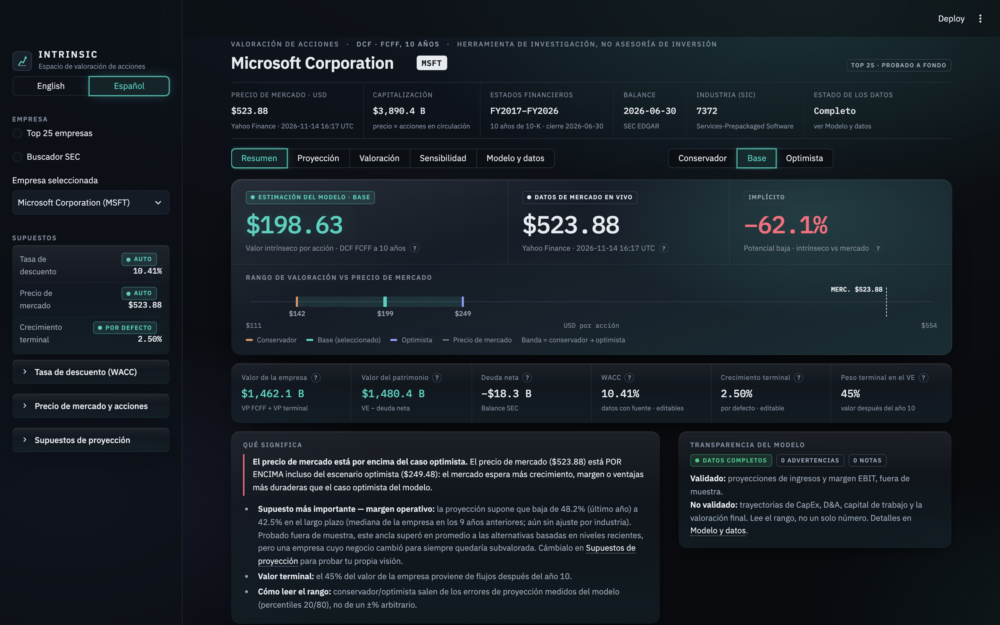

# Intrinsic — Valoración DCF automatizada a partir de reportes de la SEC

**Informe técnico** · Noviembre 2026 · *English version: [REPORT.md](REPORT.md)*

> Intrinsic es un proyecto de portafolio creado para demostrar modelación financiera, ingeniería de datos y
> validación cuantitativa. Es una herramienta de investigación, no un producto profesional de inversión, y nada
> en él constituye asesoría de inversión.


---

## 1. Resumen

Intrinsic valora empresas que cotizan en EE. UU. con un modelo de **flujo de caja libre de la empresa (FCFF)**
descontado a diez años, construido solo con datos públicos: estados financieros de **SEC EDGAR**, datos de
mercado de **Yahoo Finance** y conjuntos de referencia fechados de **Aswath Damodaran (NYU Stern)**. El usuario
elige una empresa y la aplicación descarga su historia de reportes 10-K, la audita, proyecta ingresos, márgenes
y reinversión, descuenta los flujos a un costo de capital con fuentes y muestra el valor intrínseco por acción
como un rango frente al precio de mercado, en inglés o en español.

Tres decisiones de diseño lo distinguen de un DCF típico de estudiante:

1. **Un solo modelo integrado por impulsores**, no una colección de reglas por métrica. Cada variable parte del
   último año reportado y converge a un ancla de largo plazo a una velocidad estimada en 2.578 empresas; el
   CapEx y la depreciación salen del mismo roll-forward del activo fijo, así que no pueden contradecirse.
2. **Validado antes de confiar en él.** El diseño y cinco criterios de aprobación se congelaron antes de probarlo
   con 800 empresas que el modelo nunca había visto, proyectando desde 2019. Cumplió los cinco. Las ideas que
   perdieron fuera de muestra se descartaron y quedaron documentadas.
3. **Rechaza en lugar de adivinar.** Los estados financieros faltantes bloquean la valoración en vez de rellenarse
   con ceros; bancos, aseguradoras, REIT, emisores extranjeros y empresas con pérdidas se rechazan mostrando el
   motivo.

## 2. El problema

Automatizar un DCF es fácil; automatizar uno *defendible* no lo es. Las primeras versiones de Intrinsic usaban
promedios y medianas históricas para cada métrica, y fallaban de forma predecible: los promedios ignoran los
cambios estructurales (el gasto de capital de Microsoft desde 2023), extrapolan crecimientos extraordinarios
(NVIDIA) y tratan cada línea del flujo de caja por separado, de modo que CapEx y depreciación podían terminar en
combinaciones económicamente imposibles. Dos enfoques más elaborados —un modelo "híbrido" de corto y largo plazo
y un *selector adaptativo* que elegía el mejor método por métrica según errores pasados— daban valoraciones muy
distintas para la misma empresa y no se pudo demostrar que fueran mejores fuera de muestra.

El objetivo pasó a ser: **un solo modelo, cada parámetro medido con datos o marcado como supuesto, y toda
afirmación sobre su precisión respaldada por una prueba fuera de muestra.**

## 3. Arquitectura

```
 SEC EDGAR (CompanyFacts, submissions)       Yahoo Finance               Damodaran, ene 2026
            │                                      │                             │
            ▼                                      ▼                             ▼
  sec_data · sec_tags · sec_history       market_data · market_reference   industry_beta · wacc_inputs
  balance_sheet · operating_capital                │                             │
            │  historia auditada de 10 años,        │ precio, acciones,           │ betas por industria,
            │  puente al patrimonio, sector         │ bono del Tesoro a 10 años   │ prima implícita, spreads
            ▼                                      ▼                             ▼
     inputs.load_inputs ───────────────►  forecast.run  ◄──────────────  wacc_data → WACC
                                               │  FCFF a 10 años, valor terminal, puente al patrimonio
                                               ▼
                         dashboard_panel + app.py (Streamlit, inglés / español)
```

El código es un paquete de Python (`intrinsic/`) con una interfaz en Streamlit (`app.py`), una carpeta
`validation/` con todos los scripts de calibración y prueba, datos de referencia fechados en `data/` y 79 tests
unitarios que GitHub Actions corre en cada push. Las versiones anteriores se conservan, sin uso, en `archive/`.

## 4. Pipeline de datos

**Fuente.** El *CompanyFacts* en XBRL de cada empresa (cada número etiquetado de cada 10-K) y el endpoint
*submissions* (código de industria SIC, tipo de emisor). Las respuestas se guardan en caché local; la SEC exige
un User-Agent identificable, que se lee de una variable de entorno.

**Tal como se reportó originalmente.** CompanyFacts mezcla valores originales y reexpresados. Para calibrar y
validar, Intrinsic toma el valor **presentado por primera vez** de cada año fiscal, así una proyección hecha "en
2018" solo usa lo que se sabía en 2018. El dashboard en vivo usa los valores más recientes.

**Conciliación de etiquetas.** Las empresas reportan el mismo concepto con distintas etiquetas XBRL (por ejemplo,
los ingresos con cinco etiquetas alternativas, la deuda como total o por componentes). Cada línea tiene una lista
de prioridad; un total reportado siempre gana sobre una suma de componentes parciales, y cada valor guarda la
etiqueta de la que salió. Si falta la utilidad operativa, se deriva de la utilidad antes de impuestos y los
intereses, y se marca como *derivada*.

**Puente al patrimonio.** Deuda neta = deuda (incluidos arrendamientos financieros) − caja − inversiones de corto
plazo − inversiones no operativas, todo a la misma fecha de balance. Las acciones son el promedio ponderado
diluido del último año.

**Clasificación por sector.** El código SIC decide si aplica el FCFF. Bancos, aseguradoras, REIT y sociedades de
cartera se envían a una página de "fuera del alcance de este modelo" *antes* de cargar datos de mercado, con una
explicación de por qué necesitan otro modelo.

**Política de rechazo.** Una valoración se bloquea, mostrando el motivo, cuando no se pueden verificar los
ingresos, la utilidad operativa, el activo fijo o el puente al patrimonio; cuando la empresa presenta el Form
20-F/40-F o reporta bajo IFRS; cuando tiene menos de tres años de historia; o cuando la proyección nunca alcanza
una utilidad operativa terminal positiva.

## 5. Modelo de proyección

Cada impulsor sigue la misma regla: parte de la última observación y converge a un ancla de largo plazo.

| Impulsor | Ecuación | Parámetros |
|---|---|---|
| Crecimiento de ingresos | g<sub>t</sub> = g<sub>T</sub> + (g<sub>0</sub> − g<sub>T</sub>) · φ<sup>t</sup> | g<sub>0</sub> último crecimiento; g<sub>T</sub> crecimiento terminal (2,5%); φ estimado en el panel |
| Margen operativo | m<sub>t</sub> = m\* + (m<sub>0</sub> − m\*) · ψ<sup>t</sup> | m\* mediana de los 9 años anteriores; ψ estimado en el panel |
| Intensidad de capital | ActivoFijo<sub>t</sub> = k<sub>t</sub> · Ingresos<sub>t</sub> | k converge a la mediana de la empresa |
| Depreciación | Dep<sub>t</sub> = δ · ActivoFijo<sub>t−1</sub> | δ de la historia de la empresa |
| CapEx | ΔActivoFijo<sub>t</sub> + Dep<sub>t</sub> | se deriva de las dos líneas anteriores |
| Capital de trabajo | CT<sub>t</sub> = n<sub>t</sub> · Ingresos<sub>t</sub> | puede ser negativo (los clientes financian el crecimiento) |
| I+D | capitalizado y amortizado según la vida útil de la industria | vida útil según el SIC |
| Impuestos | tasa efectiva → 25% marginal al año 10 | 21% federal + ~4% estatal |
| Valor terminal | NOPAT<sub>H+1</sub> · (1 − g / RONIC) / (WACC − g) | reinversión consistente con el crecimiento |

**Calibración.** Los pesos de convergencia se estiman en un panel de 2.578 empresas no financieras de NYSE y
Nasdaq, regresando la desviación futura respecto del ancla sobre la desviación de hoy, de 1 a 5 años adelante.
Las estimaciones por tamaño de ingresos se ajustan hacia el valor de todas las empresas (agrupación parcial con
200 pseudo-observaciones). Valores actuales: φ = 0,19 para el crecimiento (el exceso de crecimiento se disipa
rápido), ψ = 0,87 para el margen y 0,98 para la intensidad de capital (ambos persistentes).

**Escenarios.** El conservador y el optimista son los percentiles 20 y 80 de los propios errores fuera de muestra
del modelo para ingresos y margen, escalados a la volatilidad histórica de cada empresa. El conservador además
supone que, en el período terminal, la nueva inversión solo rinde su costo de capital.

## 6. Tasa de descuento

| Dato | Valor por defecto y fuente | Por qué |
|---|---|---|
| Tasa libre de riesgo | Rendimiento del bono del Tesoro a 10 años del día (Yahoo Finance ^TNX) | coincide con la larga duración de los flujos del patrimonio |
| Prima de riesgo de mercado | 4,23%, prima implícita del S&P 500 de Damodaran, 1 de enero de 2026 | implícita en el mercado y fechada |
| Beta | Beta desapalancada de la industria (corregida por caja), reapalancada con el D/E de la empresa: β<sub>L</sub> = β<sub>U</sub>(1 + (1 − t)·D/E) | el promedio de muchas empresas tiene mucho menos ruido que la regresión de una sola acción |
| Costo de la deuda | Tasa libre de riesgo + spread de una calificación sintética según la cobertura de intereses (EBIT / intereses) | el costo de endeudarse hoy, no cupones antiguos |
| Tasa impositiva | 25% marginal | la misma tasa a la que converge la proyección |

El código SIC se asigna a las 94 industrias de Damodaran con una tabla explícita; cada asignación se marca como
*específica* o *amplia*, y el usuario puede elegir otra industria cuando un solo código no describe un negocio
con varios segmentos. Cada dato muestra su fuente y se puede editar.

## 7. Validación

### 7.1 Diseño

Los parámetros se estimaron con empresas de desarrollo usando datos hasta el 31 de diciembre de 2018. El diseño
—versión de los datos, definición del ancla, horizontes y cinco criterios de aprobación— se guardó en
`validation/results/frozen_design.json` **antes** de evaluar las proyecciones en 800 empresas nuevas de NYSE y
Nasdaq desde 2019. Los errores se agrupan por empresa, por eso los intervalos de confianza usan un bootstrap por
bloques de empresa.

| Criterio | Resultado |
|---|---|
| R1 · ingresos a 3 años: supera al paseo aleatorio (límite superior del IC < 0) | Cumple |
| R2 · ingresos a 5 años: supera al paseo aleatorio | Cumple |
| R3 · ingresos a 5 años: supera a la mediana histórica | Cumple |
| M1 · margen: no es peor que el paseo aleatorio en ningún horizonte | Cumple |
| B1 · sesgo de ingresos a 5 años menor a 10% | Cumple (−5,8%) |

### 7.2 Resultados



| Horizonte | MAE de ingresos (nivel en log, %): Intrinsic / mediana / paseo aleatorio | MAE de margen (pp): Intrinsic / mediana / paseo aleatorio |
|---|---|---|
| 1 año | **15,8** / 17,6 / 20,3 | **8,3** / 11,4 / 8,5 |
| 3 años | **31,4** / 41,9 / 61,6 | **10,9** / 11,6 / 11,7 |
| 5 años | **37,8** / 57,6 / 86,2 | **11,2** / 12,0 / 12,4 |

La mejora es mayor justo donde un DCF la necesita: a cinco años el error de ingresos es un tercio menor que el de
la mediana histórica y menos de la mitad que el de extrapolar el crecimiento actual.

### 7.3 Lo que se probó y se descartó

| Idea | Resultado |
|---|---|
| Selector adaptativo: elegir el mejor método por métrica según errores pasados | Inestable con muestras pequeñas; no superó de forma consistente al mejor método individual. Reemplazado por un solo modelo. |
| Ancla del margen = mediana de 3 o 5 años, mediana de la industria o una mezcla 50/50 | Ninguna superó a la mediana de 9 años (`validation/compare_margin_anchors.py`). |
| Mover el ancla a niveles recientes cuando los últimos tres años están todos por encima (o por debajo) de la mediana | Registrada de antemano y descartada: en los casos donde se activaba, el error subió de 8,22 a 8,46 pp a 3 años y de 9,22 a 9,54 pp a 5 años (`validation/compare_regime_anchor.py`). |

### 7.4 Cobertura más allá del Top 25

El dashboard está probado a fondo con su lista Top 25 (22 valoradas; JPMorgan, Bank of America y Berkshire
Hathaway quedan fuera de alcance). `validation/universe_coverage.py` toma empresas al azar de NYSE y Nasdaq,
una acción por empresa, y repite los mismos pasos que el dashboard. Con 60 empresas no financieras: **22
valoradas (37%)**; 18 rechazadas por ser emisores extranjeros, 11 por pérdidas, 4 por datos de depreciación
inutilizables, 3 sin ingresos todavía, 2 con menos de tres años de historia; **cero errores inesperados**. Entre
las empresas rentables de EE. UU. que presentan el 10-K, se valora el 71%.

## 8. Caso de estudio: Microsoft

*Cifras calculadas el 14 de noviembre de 2026; la aplicación en vivo actualiza los datos de mercado, así que los
valores cambian levemente.*

### 8.1 Historia e impulsores

Los ingresos pasaron de $96,6 mil millones (año fiscal 2017) a $331,8 mil millones (2026); el margen operativo
antes de la amortización de intangibles adquiridos subió de 31,8% a 48,2%.

| Impulsor | Valor | Fuente |
|---|---|---|
| Crecimiento de ingresos, último año | 17,8% | dato |
| Convergencia del crecimiento φ | 0,20 | calibrado (grupo >$100 mil millones combinado con todas las empresas) |
| Margen operativo, último → largo plazo | 48,2% → 42,5% | dato (mediana de los 9 años anteriores) |
| Convergencia del margen ψ | 0,84 | calibrado |
| Activo fijo neto / ingresos, último → largo plazo | 94% → 36% | dato; refleja la reciente inversión en infraestructura de IA |
| Capital de trabajo / ingresos | −8,7% → −15,3% | dato (los clientes pagan por adelantado) |
| Impuestos, efectiva → marginal | 19,4% → 25% | dato / supuesto |

### 8.2 Tasa de descuento

Tasa libre de riesgo 5,15% · prima 4,23% · beta 1,26 (Software — System & Application, desapalancada 1,25 en
309 empresas, D/E 1,0%; beta de regresión de Yahoo 1,05) · costo del patrimonio 10,48% · cobertura de intereses
50,9× → AAA → costo de la deuda antes de impuestos 5,55% · pesos 99,0% patrimonio / 1,0% deuda → **WACC 10,42%**.

### 8.3 Proyección (escenario base, miles de millones de USD)

| | 2027 | 2028 | 2029 | 2030 | 2031 | 2036 |
|---|---:|---:|---:|---:|---:|---:|
| Ingresos | 350,5 | 361,5 | 371,0 | 380,4 | 389,9 | 441,1 |
| Crecimiento | 5,6% | 3,1% | 2,6% | 2,5% | 2,5% | 2,5% |
| Margen operativo | 46,2% | 45,7% | 45,4% | 45,1% | 44,9% | 43,5% |
| NOPAT | 135,9 | 136,8 | 137,3 | 138,3 | 139,8 | 147,2 |
| CapEx | 80,0 | 75,6 | 75,5 | 76,4 | 77,4 | 83,4 |
| D&A | 69,7 | 71,7 | 72,2 | 72,4 | 72,5 | 77,9 |
| FCFF | 124,7 | 131,8 | 133,3 | 133,8 | 134,3 | 140,9 |
| ROIC | 38,7% | 37,3% | 36,7% | 36,4% | 36,3% | 35,5% |

### 8.4 Valoración

| | USD |
|---|---:|
| VP del FCFF, 2027–2036 | 806,4 mil millones |
| VP del valor terminal (44,8% del VE; RONIC 35,7%, reinversión 7,0% del NOPAT) | 654,9 mil millones |
| Valor de la empresa | 1.461,4 mil millones |
| Deuda neta (caja neta) | −18,3 mil millones |
| Valor del patrimonio | 1.479,7 mil millones |
| Acciones diluidas | 7.453 millones |
| **Valor intrínseco por acción (base)** | **$198,53** |
| Conservador / optimista | $141,74 / $249,35 |
| Precio de mercado | $523,88 |


### 8.5 Cómo leer la diferencia

El precio de mercado está por encima incluso del escenario optimista. En lugar de ajustar el modelo hasta que
coincida, Intrinsic se pregunta qué implica el precio. Mantener el crecimiento cerca del 17% actual durante toda
la década (ingresos de unos $1,6 billones en 2036) todavía da $475; subir solo el margen de largo plazo, incluso
a 95%, da $359; solo un WACC cercano a 5,4% reproduce el precio. El mercado, entonces, descuenta un crecimiento
que persiste mucho más allá de un horizonte de diez años, o un retorno exigido mucho menor, de lo que respalda la
evidencia del modelo. El panel muestra que ese nivel de crecimiento rara vez se ha sostenido, y por eso la
convergencia calibrada es rápida; por la misma razón, el modelo subvalorará a la rara empresa que sí lo sostenga.
El dashboard muestra este supuesto en su primera página para que el usuario pruebe su propia visión.

## 9. La aplicación



- **Resumen**: valor intrínseco, precio de mercado y potencial implícito; el rango de conservador a optimista
  frente al precio de mercado; valor de la empresa y del patrimonio; un veredicto en lenguaje simple y el
  supuesto más importante.
- **Proyección**: historia reportada y los tres escenarios, una tabla tipo estado financiero (reales vs
  estimados) y exportación a CSV.
- **Valoración**: el puente al patrimonio, cómo se construye el valor año a año y el paso del valor de la
  empresa al valor del patrimonio.
- **Sensibilidad**: una matriz WACC × crecimiento terminal coloreada en torno al precio de mercado.
- **Modelo y datos**: qué está validado y qué no, la fuente de cada impulsor (dato de la empresa, calibrado,
  supuesto económico o dato del usuario) y todas las revisiones de calidad de datos.

Cada dato se puede editar y se marca como *Auto*, *Por defecto*, *Editado* o *Manual*; el color indica el origen
(modelo, mercado, usuario). La interfaz es completamente bilingüe (inglés / español) y un test unitario falla si
algún texto no tiene traducción. El **buscador SEC** abre cualquier empresa registrada bajo un aviso visible de
*beta*.

## 10. Limitaciones y trabajo futuro

- **Alcance.** Empresas no financieras que presentan el Form 10-K bajo US GAAP. Bancos y aseguradoras necesitan
  modelos basados en el patrimonio; los emisores extranjeros (20-F) y las empresas con pérdidas se rechazan por
  ahora.
- **Lo que no está validado.** Las trayectorias de CapEx, D&A y capital de trabajo son consistentes por
  construcción pero no se evaluaron como proyecciones; los años 6 a 10, el valor terminal y la valoración final
  no están validados.
- **Ancla del margen.** La mediana de nueve años ganó en promedio fuera de muestra, pero subvalora a una empresa
  cuya economía cambió para siempre. Se muestra en el Resumen y se puede editar.
- **Una industria por empresa.** Un solo código SIC le da a las empresas con varios segmentos una sola beta (un
  minorista con una división de nube); el usuario puede elegir otra industria.
- **Inconsistencia conocida.** Los pesos del WACC usan la deuda financiera del balance, mientras que el puente al
  patrimonio también resta los arrendamientos financieros (en Microsoft, $40,3 mil millones vs $106,9 mil
  millones). El efecto en el WACC es pequeño en este caso (peso de la deuda de alrededor de 1%) y es la próxima
  corrección.
- **Datos de mercado** de Yahoo Finance, que pueden no estar disponibles o tener límites de uso.

**Próximos pasos:** soporte para emisores 20-F y empresas con pérdidas (con un camino explícito a la
rentabilidad), un motor basado en el patrimonio para empresas financieras, betas ponderadas por segmento y un
tratamiento consistente de los arrendamientos en el WACC.

## 11. Reproducibilidad

```bash
pip install -r requirements.txt
export INTRINSIC_SEC_USER_AGENT="Intrinsic tu.nombre@ejemplo.com"
streamlit run app.py                               # el dashboard
python -m unittest discover -s tests               # 79 tests unitarios
python -m validation.calibrate_fade --n 500        # reconstruir el panel y la calibración
python -m validation.final_validation              # evaluar el diseño congelado con empresas nuevas
python -m validation.compare_regime_anchor         # una prueba de ancla registrada de antemano
python -m validation.universe_coverage             # cobertura del universo de la SEC
```

Datos: SEC EDGAR (dominio público); Yahoo Finance mediante `yfinance`; Aswath Damodaran, NYU Stern — betas por
industria, prima de riesgo implícita y spreads por calificación (enero 2026), guardados como copias fechadas en
`data/`.
