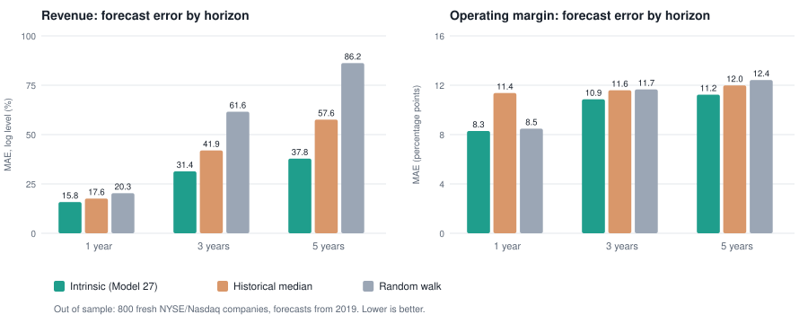
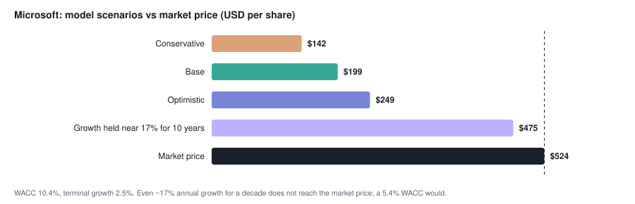
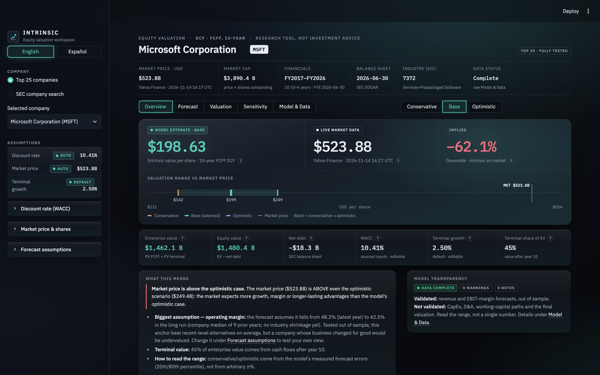
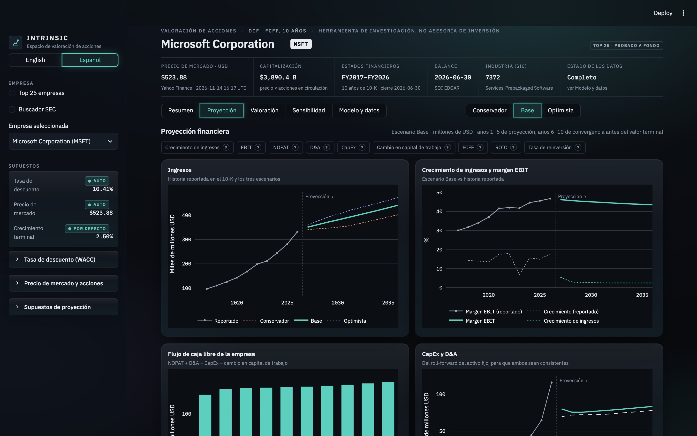

# Intrinsic — Automated DCF Valuation from SEC Filings

**Technical report** · November 2026 · **Live app:** [intrinsic-dcf.streamlit.app](https://intrinsic-dcf.streamlit.app) · *Versión en español: [INFORME.md](INFORME.md)*

> Intrinsic is a portfolio project built to demonstrate financial modelling, data engineering and
> quantitative validation. It is a research tool, not a professional investment product, and nothing in it
> is investment advice.


---

## 1. Summary

Intrinsic values US public companies with a ten-year **free cash flow to the firm (FCFF)** discounted cash flow
model built entirely from public data: financial statements from **SEC EDGAR**, market data from **Yahoo
Finance** and dated reference datasets from **Aswath Damodaran (NYU Stern)**. A user picks a company and the
application downloads its 10-K history, audits it, forecasts revenue, margins and reinvestment, discounts the
cash flows at a sourced cost of capital and shows the intrinsic value per share as a range next to the market
price, in English or Spanish.

Three design choices distinguish it from a typical student DCF:

1. **One integrated driver model**, not a collection of per-metric heuristics. Every driver starts from the
   latest reported year and converges to a long-run anchor at a speed estimated on 2,578 companies; CapEx and
   depreciation come from the same fixed-asset roll-forward, so they cannot contradict each other.
2. **Validated before it was trusted.** The design and five pass/fail criteria were frozen before a test on 800
   companies the model had never seen, forecasting from 2019 onward. All five criteria passed. Ideas that lost
   out of sample were rejected and are documented.
3. **It refuses rather than guesses.** Missing statements block a valuation instead of being filled with zeros;
   insurers, REITs, hyperinflationary-currency filers and development-stage companies are refused with the
   reason shown.

## 2. Problem

Automating a DCF is easy; automating a *defensible* one is not. The early versions of Intrinsic used historical
averages and medians for each metric. They failed in predictable ways: averages ignore structural change
(Microsoft's capital spending after 2023), extrapolate extraordinary growth (NVIDIA) and treat each line of the
cash flow independently, so CapEx and depreciation could drift into economically impossible combinations. Two
more elaborate approaches — a "hybrid" short/long-term model and an *adaptive selector* that picked the best
method per metric from past errors — produced very different valuations for the same company and could not be
shown to be better out of sample.

The goal therefore became: **one model, every parameter either measured from data or labelled as an
assumption, and every claim about accuracy backed by an out-of-sample test.**

## 3. Architecture

```
 SEC EDGAR (CompanyFacts, submissions)       Yahoo Finance               Damodaran, Jan 2026
            │                                      │                             │
            ▼                                      ▼                             ▼
  sec_data · sec_tags · sec_history       market_data · market_reference   industry_beta · wacc_inputs
  balance_sheet · operating_capital                │                             │
            │  audited 10-year history,             │ price, shares,              │ industry betas, implied ERP,
            │  equity bridge, sector routing        │ 10-year Treasury            │ rating spreads
            ▼                                      ▼                             ▼
     inputs.load_inputs ───────────────►  forecast.run  ◄──────────────  wacc_data → WACC
                                               │  10-year FCFF, terminal value, equity bridge
                                               ▼
                         dashboard_panel + app.py (Streamlit, English / Spanish)
```

The code is a Python package (`intrinsic/`) with a Streamlit front end (`app.py`), a `validation/` folder with
every calibration and test script, dated data snapshots in `data/`, and 79 unit tests run by GitHub Actions on
every push. Earlier iterations are kept, unused, in `archive/`.

## 4. Data pipeline

**Source.** XBRL *CompanyFacts* for each registrant (every tagged number in every 10-K) and the *submissions*
endpoint (SIC industry code, filer type). Responses are cached locally; the SEC requires an identifying
User-Agent, read from an environment variable.

**As originally reported.** CompanyFacts mixes original and restated values. For calibration and validation,
Intrinsic selects the **first-filed** value of each fiscal year, so a forecast made "in 2018" only uses what was
known in 2018. The live dashboard uses the latest values.

**Tag reconciliation.** Companies report the same concept under different XBRL tags (for example, revenue under
five alternative tags, debt as a total or as components). Each line has a priority list; a reported total always
beats a sum of partial components, and every value carries the tag it came from. Operating income missing from
the filing is derived from pretax income and interest and flagged as *derived*.

**Equity bridge.** Net debt = debt (including finance leases) − cash − short-term investments − non-operating
investments, all at the same balance-sheet date. Shares are the diluted weighted average for the latest year.

**Sector routing.** The SIC code decides whether FCFF applies. Banks, insurers, REITs and holding companies are
routed to an "outside the scope of this model" page *before* any market data is loaded, with an explanation of
why a different model is needed.

**Foreign private issuers (November 2026).** Companies filing Form 20-F or 40-F are adapted at load time so
the engine reads them like a 10-K filer: the annual report is relabelled; IFRS concepts are mapped to their US GAAP
equivalents (lease liabilities under IFRS 16 are treated as debt, consistent with operating profit before lease
interest); amounts in another currency are converted to USD at Yahoo Finance rates, flows at the fiscal-year
average and balances at the closing rate, and convenience translations are discarded so currencies never mix.
Hyperinflationary currencies (IAS 29, e.g. ARS, TRY) are refused. Shares trade as ADSs: the ADS ratio is inferred
from SEC ordinary shares vs the market count (whole-number match within 5%), otherwise the market count is used
and flagged. US 10-K filers are untouched.

**Refusal policy.** A valuation is blocked, with the reason shown, when revenue, operating income, fixed assets
or the equity bridge cannot be verified; when it reports in a hyperinflationary currency; when it has
fewer than three years of history; or when the forecast never reaches a positive terminal operating profit.

## 5. Forecasting model

Each driver follows the same rule — start at the latest observation, converge to a long-run anchor:

| Driver | Equation | Parameters |
|---|---|---|
| Revenue growth | g<sub>t</sub> = c<sub>t</sub> + (g<sub>0</sub> − c) · φ<sup>t</sup>; c<sub>t</sub> = c in years 1–5, then linear to g<sub>T</sub> by year 10 | g<sub>0</sub> latest growth; c median growth of the panel (6.8%); g<sub>T</sub> terminal growth (2.5%); φ panel-estimated |
| Operating margin | m<sub>t</sub> = m\* + (m<sub>0</sub> − m\*) · ψ<sup>t</sup> | m\* median of the prior 9 years; ψ panel-estimated |
| Capital intensity | NetPPE<sub>t</sub> = k<sub>t</sub> · Revenue<sub>t</sub> | k converges to the company median |
| Depreciation | Dep<sub>t</sub> = δ · NetPPE<sub>t−1</sub> | δ from company history |
| CapEx | ΔNetPPE<sub>t</sub> + Dep<sub>t</sub> | follows from the two lines above |
| Working capital | NWC<sub>t</sub> = n<sub>t</sub> · Revenue<sub>t</sub> | negative allowed (customers finance growth) |
| R&D | capitalised and amortised over an industry life | SIC-based asset life |
| Tax | effective rate → 25% marginal by year 10 | 21% federal + ~4% state |
| Terminal value | NOPAT<sub>H+1</sub> · (1 − g / RONIC) / (WACC − g) | reinvestment consistent with growth |

**Loss-making companies (November 2026).** When the company's own nine-year median margin is not positive, or
the fade still leaves an operating loss in year 10, the median cannot be the anchor: it would forecast losses
forever. The margin instead moves in a straight line from today's level to the company's **industry** operating
margin (Damodaran, January 2026, same SIC crosswalk as the beta; US market without financials when the industry is
small or loses money) in 7 years, and the value is weighted by a probability of failure:
value = (1 − p) · going-concern value + p · net cash (floored at zero). The default p comes from the cash runway
(cash and short-term investments / latest operating loss): 5 or more years 10%, 2–5 years 20%, 1–2 years 35%,
under 1 year 50%; 5% if the latest year is already profitable. Target, years and p are editable assumptions,
not validated forecasts. Companies whose operating losses exceed their revenue are still refused (development
stage). The volatility that scales the scenario bands is capped (growth 0.45, margin 0.15), above every Top 25
company, so erratic small-company histories do not produce meaningless optimistic cases. None of the 22 valued
Top 25 companies is affected.

**Calibration.** The fade weights are estimated on a panel of 2,578 NYSE/Nasdaq non-financial companies by
regressing the future deviation from the anchor on today's deviation, h = 1…5 years ahead. Estimates by revenue
size bucket are shrunk toward the all-company value (partial pooling with 200 pseudo-observations). Current
production values: φ = 0.19 for growth (excess growth decays quickly), ψ = 0.87 for margins and 0.98 for capital
intensity (both persistent). Growth is measured against the panel's median growth c = 6.8%, so the forecast fades
the excess toward c, not straight to terminal growth; c then glides to terminal growth over years 6–10. (Until
November 2026 the forecast faded straight to 2.5%, which double-counted the reversion and cut values by 15–30%.)

**Scenarios.** Conservative and optimistic are the 20th and 80th percentiles of the model's own out-of-sample
forecast errors for revenue and margin, scaled to each company's historical volatility. The conservative case
also assumes new investment earns only its cost of capital in the terminal period.

## 6. Discount rate

| Input | Default and source | Why |
|---|---|---|
| Risk-free rate | Live US 10-year Treasury yield (Yahoo Finance ^TNX) | matches the long duration of equity cash flows |
| Equity risk premium | 4.23%, Damodaran implied ERP for the S&P 500, 1 Jan 2026 | market-implied and dated |
| Beta | Industry unlevered beta (cash-corrected) relevered with the company's D/E: β<sub>L</sub> = β<sub>U</sub>(1 + (1 − t)·D/E) | averages across many firms are far less noisy than one stock's regression |
| Cost of debt | Risk-free + default spread of a synthetic rating from interest coverage (EBIT / interest) | today's borrowing cost, not old coupons |
| Tax rate | 25% marginal | same rate the forecast converges to |

The SIC code is mapped to Damodaran's 94 industries with an explicit crosswalk; matches are labelled *specific*
or *broad*, and the user can choose another industry when one code cannot describe a multi-segment business.
Every input shows its source and stays editable.

## 7. Validation

### 7.1 Design

Parameters were estimated on development companies using data up to 31 December 2018. The design — data
vintage, anchor definition, horizons and five pass/fail criteria — was written to
`validation/results/frozen_design.json` **before** forecasts were scored on 800 fresh NYSE/Nasdaq companies
for 2019 onward. Errors are clustered by company, so confidence intervals use a company-block bootstrap.

| Criterion | Result |
|---|---|
| R1 · revenue, 3 years: beats random walk (CI upper < 0) | Pass |
| R2 · revenue, 5 years: beats random walk | Pass |
| R3 · revenue, 5 years: beats historical median | Pass |
| M1 · margin: not worse than random walk at any horizon | Pass |
| B1 · revenue bias at 5 years below 10% | Pass (−5.8%) |

### 7.2 Results



| Horizon | Revenue MAE (log level, %): Intrinsic / median / random walk | Margin MAE (pp): Intrinsic / median / random walk |
|---|---|---|
| 1 year | **15.8** / 17.6 / 20.3 | **8.3** / 11.4 / 8.5 |
| 3 years | **31.4** / 41.9 / 61.6 | **10.9** / 11.6 / 11.7 |
| 5 years | **37.8** / 57.6 / 86.2 | **11.2** / 12.0 / 12.4 |

The gain is largest where a DCF needs it: at five years the revenue error is a third lower than the historical
median and less than half that of extrapolating today's growth.

### 7.3 What was tested and rejected

| Idea | Outcome |
|---|---|
| Adaptive selector: choose the best method per metric from past errors | Unstable on small samples; did not consistently beat the best single method. Replaced by one model. |
| Margin anchor = median of 3 or 5 years, industry median, or a 50/50 blend | None beat the 9-year median (`validation/compare_margin_anchors.py`). |
| Move the anchor to recent levels when the last three years all sit above (or below) the median | Pre-registered and rejected: on the cases where it triggered, errors rose from 8.22 to 8.46 pp at 3 years and from 9.22 to 9.54 pp at 5 years (`validation/compare_regime_anchor.py`). |

### 7.4 Coverage beyond the Top 25

The dashboard is fully tested on its Top 25 list (22 with the FCFF model; JPMorgan and Bank of America with
the bank engine; Berkshire Hathaway, filed as an insurer, is out of scope). `validation/universe_coverage.py` samples random NYSE/Nasdaq companies, one listing
per company, and runs the same steps as the dashboard. On 60 non-financial companies: **40 valued (67%)**, up
from 22 (37%) before the path to profitability and the foreign-filer adapter; 7 refused as development stage, 6
for unusable depreciation data, 3 with no revenue yet, 2 with under three years of history, 1 for a
hyperinflationary currency and 1 with no operating income tagged; **zero unexpected errors**. Of the 18 foreign
filers, 11 are now valued. (The coverage script also stopped counting companies without an SEC share count as
valued before running the model; one such case was previously miscounted.)

### 7.5 Do the verdict's signals predict returns? (historical backtest, November 2026)

`validation/verdict_backtest.py` rebuilds the dashboard's valuation **as of each filing date** for the 403
held-out companies of the calibration panel (CIK % 5 = 0): statements keep only facts filed by that date, the
price is the one of two trading days after filing (corrected for later splits), the risk-free rate is that day's
10-year Treasury, the ERP is the Damodaran implied premium published that year, and the Monte Carlo draws errors
estimated on training companies only. Outcome: total return over 1, 3 and 5 years minus the S&P 500 (SPY).

1,506 original 10-Ks (fiscal years mid-2012 to 2020) from 214 companies; 189 companies have none (108 file Form
20-F, 81 listed after 2020). 797 were valued (the rest are the app's own refusals: development stage, missing
EBIT, incomplete bridge); 41 were dropped as data errors (price under $1 or value/price beyond 10×, e.g. share
counts reported in thousands), leaving **756 valuations of 129 companies**. Statistics are robust to the heavy
tails: median excess return, share beating SPY and mean *log* excess return, with 95% intervals that resample
companies.

| Horizon | Rank corr. P(value > price) vs excess return | Top − bottom quintile of P (log excess) | Buy: beat SPY · mean log | Sell: beat SPY · mean log |
|---|---|---|---|---|
| 1 year | +0.05 [−0.01, +0.13] | +7.4% [−0.9%, +16.5%] | 49% · −5.1% | 43% · −9.8% |
| 3 years | +0.08 [−0.03, +0.18] | +20.4% [+0.2%, +44.6%] | 42% · −13.4% | 38% · −24.0% |
| 5 years | +0.03 [−0.08, +0.15] | +26.5% [−2.9%, +62.2%] | 32% · −30.0% | 34% · −41.9% |

What it shows:

- **The signal points the right way but is weak.** Every rank correlation is positive and none is clearly above
  zero; the base value / price ratio behaves the same (+0.07 [0.00, +0.14] at one year, +0.09 at three).
- **It mostly identifies losers, not winners.** The spread comes from the bottom quintile (lowest P, often a
  negative model value): −13% log excess at 1 year, −34% at 3, −59% at 5. The other four quintiles are
  indistinguishable from one another.
- **Buy did not beat the market.** Buy signals beat SPY 49%, 42% and 32% of the time at 1, 3 and 5 years. Sell
  signals did worse than Buy signals at every horizon, but the intervals overlap.
- **P(value > price) is not a probability of beating the market.** In the top quintile (P 0.75–0.99) only 47%,
  42% and 32% beat SPY. This is why the page keeps calling these probabilities conditional on the model.

Limits of the test: the panel is built from companies that trade today (data/sec_companies.csv) and Yahoo has
no prices for delisted tickers, so failures and acquisitions are missing (survivorship; it biases returns up, yet
the sample still trailed the mega-cap-led S&P 500 by a median 35% over five years); 2026 industry betas, rating
spreads, industry margins and the 25% long-run tax rate are used for every year (look-ahead); fade speeds come
from the full panel; foreign filers are absent; and 2012–2020 is one market regime.

## 8. Case study: Microsoft

*Figures computed on 14 November 2026; the live application updates market inputs, so values move slightly.*

### 8.1 History and drivers

Revenue grew from $96.6 B (FY2017) to $331.8 B (FY2026); the operating margin before acquired-intangible
amortisation rose from 31.8% to 48.2%.

| Driver | Value | Source |
|---|---|---|
| Revenue growth, latest year | 17.8% | data |
| Growth fade φ | 0.20 | calibrated (>$100 B bucket pooled with all companies) |
| Operating margin, latest → long run | 48.2% → 42.5% | data (median of 9 prior years) |
| Margin fade ψ | 0.84 | calibrated |
| Net PP&E / revenue, latest → long run | 94% → 36% | data; reflects the recent AI infrastructure build-out |
| Working capital / revenue | −8.7% → −15.3% | data (customers prepay) |
| Tax, effective → marginal | 19.4% → 25% | data / assumption |

### 8.2 Discount rate

Risk-free 5.15% · ERP 4.23% · beta 1.26 (Software — System & Application, unlevered 1.25 across 309 firms,
D/E 1.0%; Yahoo regression beta 1.05) · cost of equity 10.48% · interest coverage 50.9× → AAA → pre-tax cost
of debt 5.55% · weights 99.0% equity / 1.0% debt → **WACC 10.42%**.

### 8.3 Forecast (base scenario, USD billions)

| | 2027 | 2028 | 2029 | 2030 | 2031 | 2036 |
|---|---:|---:|---:|---:|---:|---:|
| Revenue | 350.5 | 361.5 | 371.0 | 380.4 | 389.9 | 441.1 |
| Growth | 5.6% | 3.1% | 2.6% | 2.5% | 2.5% | 2.5% |
| Operating margin | 46.2% | 45.7% | 45.4% | 45.1% | 44.9% | 43.5% |
| NOPAT | 135.9 | 136.8 | 137.3 | 138.3 | 139.8 | 147.2 |
| CapEx | 80.0 | 75.6 | 75.5 | 76.4 | 77.4 | 83.4 |
| D&A | 69.7 | 71.7 | 72.2 | 72.4 | 72.5 | 77.9 |
| FCFF | 124.7 | 131.8 | 133.3 | 133.8 | 134.3 | 140.9 |
| ROIC | 38.7% | 37.3% | 36.7% | 36.4% | 36.3% | 35.5% |

### 8.4 Valuation

| | USD |
|---|---:|
| PV of FCFF, 2027–2036 | 806.4 B |
| PV of terminal value (44.8% of EV; RONIC 35.7%, reinvestment 7.0% of NOPAT) | 654.9 B |
| Enterprise value | 1,461.4 B |
| Net debt (net cash) | −18.3 B |
| Equity value | 1,479.7 B |
| Diluted shares | 7.453 B |
| **Intrinsic value per share (base)** | **$198.53** |
| Conservative / optimistic | $141.74 / $249.35 |
| Market price | $523.88 |



### 8.5 Reading the gap

The market price sits above even the optimistic scenario. Rather than tune the model until it agrees, Intrinsic
asks what the price implies with a **reverse DCF** that reuses the same engine and changes one driver at a time
(November 2026 run, price $488, base value $246, WACC 10.2%):

- **Growth:** revenue would have to grow 14.6 points a year faster than the forecast in years 1–5 (tapering to
  zero by year 10): about 15.8% a year on average over the decade instead of 5.8%.
- **Margin:** no long-run operating margin up to 75% reproduces the price with the forecast revenue path.
- **Discount rate:** the price corresponds to a WACC of 6.4%.

The market is therefore pricing growth that persists far longer, or a much lower required return, than the
model's evidence supports. The panel shows that this level of growth has rarely persisted, which is exactly why
the calibrated fade is fast, and also why the model will undervalue the rare company that does sustain it.

## 9. The application



- **Overview**: intrinsic value, market price and implied upside; the conservative-to-optimistic range against
  the market price; enterprise and equity value; a plain-language verdict and the single biggest assumption.
- **Reverse DCF**: what the company would have to deliver for the market price to be fair. Three modes, each
  solved on its own with the same engine and everything else held constant: a growth premium added to the
  calibrated path in years 1–5 and tapering to zero by year 10 (bounds −15 to +30 points a year), the long-run
  operating margin (0–75%) and the WACC (terminal growth + 0.5 points to 25%). The bounded range is scanned
  first; Brent's method (`scipy.optimize.brentq`) then solves inside a single bracket. No solution, several
  solutions or a non-monotone response are reported, never forced, and the residual is shown. These are the
  expectations embedded in the price, not forecasts or a buy/sell signal.
- **Final verdict**: Buy / Hold / Sell from a **Monte Carlo** of 1,000 valuations of the base case. Each draw
  takes one jointly observed five-year path of revenue and margin forecast errors (`data/joint_errors.json`:
  3,925 windows from 610 companies, so the correlation between revenue and margin errors is kept), a beta
  ±0.20 and an equity risk premium ±0.5 points (normal), and terminal growth ±1 point (triangular, below the
  risk-free rate, or the user's own terminal growth when that is higher, and 1 point under the drawn WACC). Errors come from companies of the same size, scaled by the
  company's own volatility below $10B and in raw points at $10B and above; companies growing more than 25% use
  a high-growth pool. Each choice was made on companies left out of the estimate (`validation/joint_errors.py`):
  the central 60% of the errors covers 49–64% of held-out errors depending on size and horizon, and the
  "revenue and margin both bad" corner occurs in 8.5% of held-out windows against 4% if they were
  independent. After year 5 the margin shift kept is the median of years 3–5, so a one-year write-off does
  not become permanent. Buy is the share of valuations above the price plus a margin of safety (15% by default),
  Sell the share below the price minus that margin, Hold the rest; Buy or Sell needs a majority. The page shows
  where the three scenarios fall in the simulation (Microsoft: conservative p16, base p57, optimistic p84 —
  so treating them as the 20th/80th percentiles was close but not exact) and the simulation's standard error.
  The revenue and margin errors are measured; the discount-rate and growth spreads are assumptions; the
  probabilities are conditional on the model and are not calibrated against realised returns (a historical
  backtest, section 7.5, finds the signal weak). The buy and sell zones are thresholds on the model value, not prices
  to trade at. Banks keep the scenario-based fit (a split lognormal through the three scenarios).
- **Forecast**: reported history and the three scenarios, a statement-style table (actuals vs estimates) and
  CSV export.
- **Valuation**: the equity bridge, the build-up of value year by year and the bridge from enterprise to equity
  value.
- **Sensitivity**: a WACC × terminal-growth grid coloured around the market price.
- **Model & Data**: what is and is not validated, the source of every driver (company data, calibrated, economic
  assumption or user input) and every data-quality check.

Every input is editable and labelled *Auto*, *Default*, *Edited* or *Manual*; colour encodes provenance (model,
market, user). The interface is fully bilingual (English / Spanish); a unit test fails if any interface string
lacks a translation. The **SEC company search** opens any registrant under a visible *beta* notice.



## 10. Limitations and future work

- **Scope.** Non-financial companies filing Form 10-K under US GAAP. Banks use their own equity engine;
  insurers, hyperinflationary-currency filers and development-stage companies are refused today. Loss-making
  companies are valued on an assumed path to profitability, which is not validated out of sample.
- **What is not validated.** CapEx, D&A and working-capital paths are consistent by construction but were not
  scored as forecasts; years 6–10, the terminal value and the final valuation are not validated.
- **Margin anchor.** The nine-year median won out of sample on average but undervalues a company whose economics
  changed for good. It is stated on the Overview page and editable.
- **One industry per company.** A single SIC code gives multi-segment firms one beta (a retailer with a cloud
  division); the user can choose another industry.
- **Lease consistency (fixed, November 2026).** The WACC weights used balance-sheet borrowings while the equity
  bridge also deducted finance leases (for Microsoft, $40.3 B vs $106.9 B). Both now use the same audited debt,
  finance leases included, and the industry beta is relevered with it. Effect: Microsoft's WACC 10.33% → 10.29%,
  value per share +$0.94; Amazon +$0.06. The worked example in section 8.2 predates this fix (1.0% debt weight).
- **Market data** comes from Yahoo Finance and can be unavailable or rate-limited.

**Next steps:** an out-of-sample test of the path to profitability, a survivorship-free rerun of the verdict backtest
(delisted prices from a point-in-time source), extending
the equity-based bank engine (live for JPMorgan and Bank of America) to insurers, and segment-weighted betas.

## 11. Reproducibility

The dashboard runs live at https://intrinsic-dcf.streamlit.app. To run it locally:

```bash
pip install -r requirements.txt
export INTRINSIC_SEC_USER_AGENT="Intrinsic your.name@example.com"
streamlit run app.py                               # the dashboard
python -m unittest discover -s tests               # 79 unit tests
python -m validation.calibrate_fade --n 500        # rebuild the panel and calibration
python -m validation.final_validation              # score the frozen design on fresh companies
python -m validation.compare_regime_anchor         # a pre-registered anchor test
python -m validation.universe_coverage             # coverage of the SEC universe
```

Data: SEC EDGAR (public domain); Yahoo Finance via `yfinance`; Aswath Damodaran, NYU Stern — industry betas,
implied equity risk premium and rating spreads (January 2026), stored as dated snapshots in `data/`.
